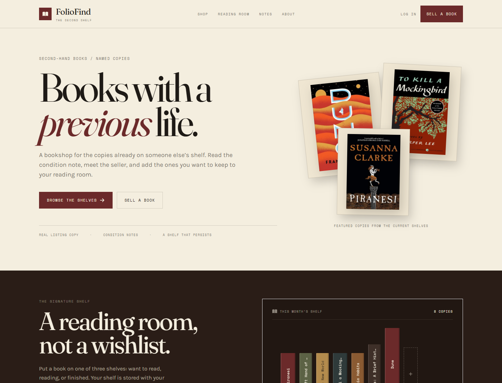
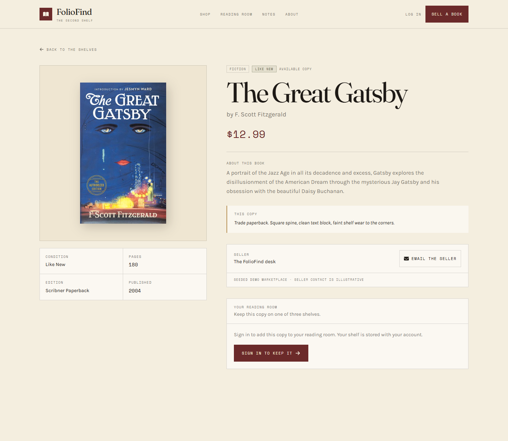
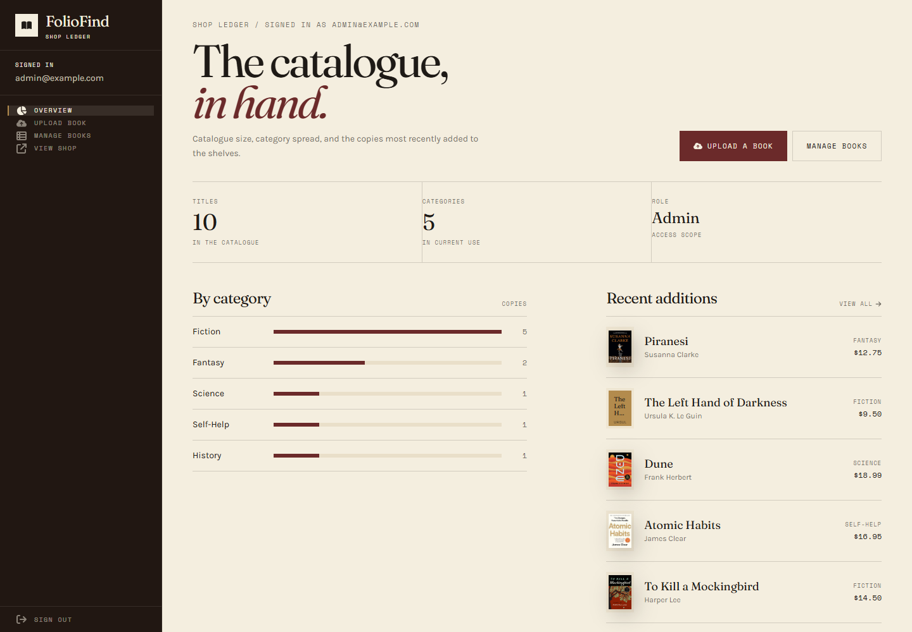

# FolioFind — The second shelf

A full-stack marketplace for second-hand books. Every listing is a specific copy: an edition, a condition note, a price, and a seller. Signed-in readers can keep a persistent **Reading Room** shelf, and sellers can list and manage their own copies.

The design direction is documented in [`DESIGN.md`](DESIGN.md).

## The idea

Most book marketplaces flatten a used book into a title, a cover, and a price. FolioFind treats the copy as the product:

- A listing names the **edition**, **pages**, **ISBN**, and **condition**.
- A **condition note** describes the actual book in the seller’s hands.
- Readers can keep a **Reading Room** with three shelves and a private note per book.
- The shop is a catalogue, not a cart. Contact with the seller is explicit and seeded for the demo.

## Stack

| Layer | Technology |
|---|---|
| Frontend | React 18 · Vite · Tailwind CSS · React Router |
| API | Node.js · Express · Zod · JWT auth |
| Data | MongoDB · native driver |
| Tests | Jest + Supertest (API) · Vitest + Testing Library (UI) |
| Deployment | Render (single web service) or split static frontend + API |

## Architecture

```
frontend/
  src/
    components/       BookCard, BookCover, AuthFrame, ScrollToTop
    contexts/         AuthProvider, ShelfProvider
    pages/            Home, Shop, SingleBook, ReadingRoom, SellBook, MyListings, About, Notes
    Dashboard/        Admin ledger, inventory, upload, edit
    api/              Typed fetch client + books, auth, shelf endpoints

backend/
  src/
    routes/           auth, books, shelf
    controllers/      books, auth, shelf
    validation/       Zod schemas
    db/               Mongo client + demo seeder
    middleware/       auth, admin guard, error handler

docs/screenshots/     Portfolio screenshots
```

## Features

### Shop and catalogue

- Browse available copies with full-card book details.
- Search by title or author, filter by category, price range, and sort by newest, price, or title.
- Pagination from the API, not client-side slicing of a single page.
- Bundled local covers, with a typographic fallback if an image is unavailable.

### Copy record

- Condition, edition, published year, pages, ISBN, and the seller’s condition note.
- Seller contact (seeded and labelled as illustrative).
- Add the copy to Want to read, Reading, or Finished, with an optional private note.

### Reading Room

- Signed-in, account-scoped shelf with counts and a spine-based visualisation.
- Move books between shelves, edit notes, and remove a copy.
- Empty-state copy and a real path back to the catalogue.

### Selling and management

- Register, sign in, and log out with JWT auth.
- List a copy with edition, condition, price, cover, pages, ISBN, and a condition note.
- My listings: view, mark sold, relist, or delete with inline confirmation.
- Admin ledger: catalogue totals, category spread, recent additions, full inventory table, upload, edit, and delete.

### API

- `GET /api/books` supports `q`, `category`, `minPrice`, `maxPrice`, `sort`, `page`, and `limit`.
- `GET /api/books/:id`
- `GET /api/books/stats` (admin)
- `POST /api/books`, `PATCH /api/books/:id`, `DELETE /api/books/:id`
- `GET /api/shelf`, `PUT /api/shelf/:bookId`, `DELETE /api/shelf/:bookId` (reader)
- `POST /api/auth/register`, `POST /api/auth/login`, `GET /api/auth/me`

## What is verified

- **47 API tests** pass across auth, catalogue, admin statistics, and the reading-room shelf.
- **Frontend tests** cover the auth provider and admin route guard.
- Search, category filtering, price sorting, pagination, selling, listing management, shelf persistence, admin upload/edit, and mobile layouts were exercised in a real browser.
- Production build passes; the frontend and API are served from the backend’s compiled `public/` directory in the single-service deployment.
- No fake testimonials, ratings, reader counts, or invented shop history.

## Screenshots

| Home | Shop |
|---|---|
|  |  |

| Copy record | Reading room |
|---|---|
|  |  |

| Admin ledger | Inventory |
|---|---|
|  |  |

## Local setup

### 1. Install

```bash
npm install
npm install --prefix backend
npm install --prefix frontend
```

or:

```bash
npm run bootstrap
```

### 2. Environment

Create `backend/.env`:

```
PORT=5000
NODE_ENV=development
MONGO_URI=mongodb://localhost:27017/BookInventory
CORS_ORIGIN=http://localhost:5173
JWT_SECRET=replace-with-a-long-random-secret
JWT_EXPIRES_IN=7d
ADMIN_EMAIL=admin@example.com
ADMIN_PASSWORD=admin123
```

Create `frontend/.env`:

```
VITE_API_BASE_URL=http://localhost:5000
```

### 3. Run

```bash
# API
npm run dev:backend

# Frontend
npm run dev:frontend
```

- Web: http://localhost:5173
- API: http://localhost:5000

The API seeds eight demo books on first start. Covers are bundled in `frontend/public/covers`.

### 4. Demo credentials

**Administrator**

```
Email:    admin@example.com
Password: admin123
```

Readers can create their own account from `/create-user`.

All books, sellers, and listings are seeded demo data. Do not enter personal or payment information.

## Tests

```bash
npm test --prefix backend
npm test --prefix frontend
```

API tests use a local MongoDB instance (or `MONGO_URI` if set) and create isolated databases per suite.

## Production build

```bash
npm run build
```

This builds the React app and copies `frontend/dist` into `backend/public`. The Express server serves the compiled app and the API from one origin.

```
Build:  npm install && npm run build
Start:  node backend/src/server.js
Health: /api/books
```

For a split deployment, host `frontend/dist` as a static site and set `CORS_ORIGIN` to its exact origin. For images, the bundled covers live under `/covers/*` in both cases.

## Demo data note

Cover images are the covers of the named editions, downloaded from OpenLibrary for this portfolio demo. Cover art remains the property of the respective publishers and designers. The listings, sellers, and condition notes are seeded demo data, not real inventory.
