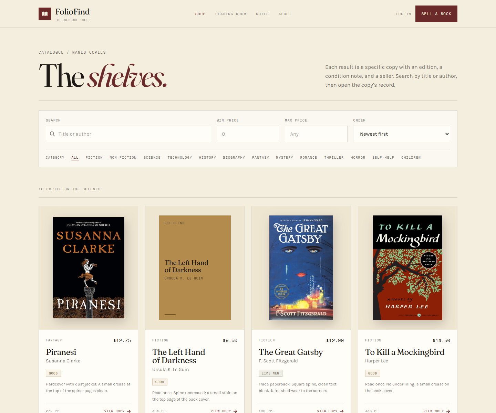
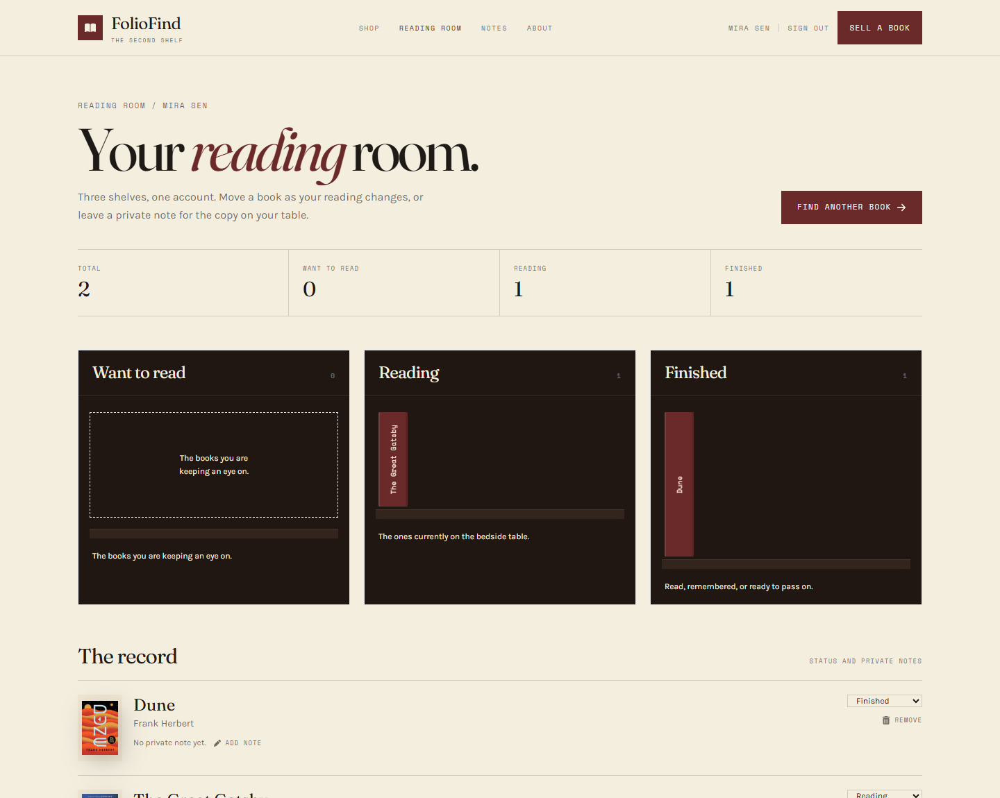
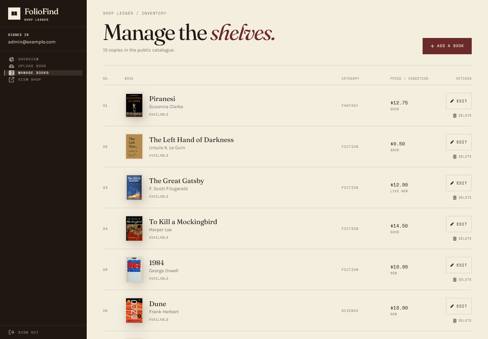

# FolioFind

> A used-book marketplace where the copy on the shelf is the product.

[](https://foliofind.furqankhan.dev)
[](https://furqankhan.dev)
[](LICENSE)

FolioFind is a marketplace for second-hand books where every listing describes a specific copy: its edition, condition, price, and the seller's note about the book in their hands. Signed-in readers keep a private three-shelf Reading Room, sellers list and manage their own copies, and an admin ledger keeps the catalogue in view. Part of [Furqan Khan's portfolio](https://furqankhan.dev).

**Live:** https://foliofind.furqankhan.dev · **Source:** https://github.com/fk219/FolioFind · **Case study:** https://furqankhan.dev

## What it is

FolioFind is the second shelf: a catalogue for books that have already been read. It is not a new-book retailer with a cart. The unit is the copy, and two copies of the same title can be different products because the edition, condition, and seller's description differ.

The shop supports search, category and price filters, sorting, and server-side pagination. A copy page carries the full record, a buyer enquiry form, and shelf controls. The Reading Room stores three account-scoped shelves with an optional private note per book. The admin side is a catalogue ledger with totals, category spread, inventory, upload, edit, and delete.

The visual direction is documented in [DESIGN.md](DESIGN.md).

## The signature idea

Most book marketplaces flatten a used book into a title, a cover, and a price. FolioFind keeps the details that make one copy different from another:

- A listing names the **edition**, **published year**, **pages**, **ISBN**, and **condition**.
- A **condition note** describes the actual book, from a square spine to a creased cover.
- The seller is part of the record, and a buyer can send an enquiry from the copy page.
- A reader can file the copy under **Want to read**, **Reading**, or **Finished**, with a private note.

The Reading Room renders those shelves as book spines on dark wood, then lists the same entries as an editable record. The shelf lives in the user's account, so it survives a reload and a new session. The catalogue has no invented ratings, testimonials, reader counts, or shop history.

## What works

- **Catalogue browsing.** Search by title or author, filter by category and price range, sort by newest, price ascending, price descending, or title, and paginate on the server.
- **Copy-level records.** Every listing carries edition, published year, pages, ISBN, condition grade (`New`, `Like New`, `Good`, `Acceptable`), and a seller-written condition note.
- **Reading Room.** Three account-scoped shelves with counts, a spine-based visualisation, private notes up to 280 characters, move, edit, and remove.
- **Selling.** Any signed-in reader can list a copy with its condition, price, cover URL, and description, then manage it from My listings.
- **Buyer enquiries.** A signed-in reader can send a 10 to 500 character enquiry on an available copy. The seller sees the message, buyer name, and buyer email in My listings.
- **Listing management.** Mark a copy sold to remove it from the public shelves, relist it, or delete it with an inline confirmation.
- **Admin ledger.** Catalogue totals, category spread, recent additions, an inventory table, upload, edit, and delete, protected by an admin route guard.
- **Accounts and demo entry.** Register, sign in, and sign out with JWT auth. The login page offers one-click demo reader and demo admin access.
- **Cover handling.** Bundled local covers under `/covers/*`, with a typographic fallback when an image is missing or fails to load.

## Screens

| Home | Shop | Copy record |
|---|---|---|
|  |  |  |

| Reading Room | Admin ledger | Inventory |
|---|---|---|
|  |  |  |

## Tech stack in detail

| Layer | Technology | What it does here |
|---|---|---|
| Web app | React 18, Vite 4, React Router 6, Tailwind CSS 3 | Storefront, copy pages, Reading Room, seller tools, and admin pages, written in JSX. |
| API | Node.js 22, Express 4 | REST routes for auth, catalogue, sellers, enquiries, admin statistics, and the shelf. |
| Data | MongoDB with the native `mongodb` driver 6 | `users` hold an embedded shelf array; `books` hold copy records; `inquiries` hold buyer messages. |
| Validation | Zod 4 | Registration, login, book create/patch, status changes, enquiries, and shelf updates. |
| Auth | JWT Bearer tokens, bcryptjs | Seven-day tokens by default, hashed passwords, and a role check for admin routes. |
| Security | Helmet with CSP, single-origin CORS, express-rate-limit | Security headers, one allowed browser origin, and 50 auth requests per 15 minutes per IP. |
| API tests | Jest 29, Supertest, MongoDB | 47 tests across auth, catalogue, admin statistics, and the shelf. |
| Web tests | Vitest, Testing Library, jsdom | Auth provider and admin route-guard tests. |
| Build and hosting | Vite build, Node copy script, Render, Vercel, MongoDB Atlas, GitHub Actions | The frontend build is copied into `backend/public`; Render can serve the whole app, while Vercel proxies `/api` to it. |

## Architecture

The React SPA talks to an Express API under `/api`. Auth routes issue a JWT; the browser stores it in `localStorage` and sends it as `Authorization: Bearer <token>`. Book routes are public for reads and authenticated for writes. The shelf router is authenticated as a whole.

Each book document stores the seller's id, email, and display name at listing time, so a listing can be rendered without a join. The shelf is an array on the user document, with `bookId`, `status`, `note`, and timestamps. The public catalogue query excludes `sold` copies. Admin statistics count the full catalogue and group it by category.

```
Browser (React SPA, JWT in localStorage)
   |  fetch /api/* with Authorization: Bearer
   v
Express API
   |-- /api/auth    register, login, me
   |-- /api/books   catalogue, seller listings, enquiries, admin stats
   |-- /api/shelf   Reading Room
   v
MongoDB
   |-- users      account + role + embedded shelf[]
   |-- books      copy record + seller snapshot + status
   |-- inquiries  buyer message + seller snapshot
```

```text
backend/
  index.js                   optional Vercel serverless entry
  src/
    app.js                   Express app, Helmet, CORS, static SPA
    server.js                startup, seeding, listen
    config.js                environment parsing
    routes/                  auth, books, shelf
    controllers/             authController, booksController, shelfController
    middleware/              requireAuth, requireAdmin, errorHandler
    validation/              Zod schemas
    db/                      Mongo client + demo seeder
  tests/                     auth, books, shelf, test database helper
  public/                    compiled SPA and bundled covers
  vercel.json                optional serverless API config
frontend/
  src/
    api/                     fetch client + auth, books, shelf endpoints
    components/              BookCard, BookCover, AuthFrame, ScrollToTop
    contexts/                AuthProvider, ShelfProvider
    Dashboard/               admin ledger, upload, manage, edit
    pages/                   Home, Shop, SingleBook, ReadingRoom,
                             SellBook, MyListings, About, Blog, shared
    PrivateRoute/            admin guard
    routers/                 React Router configuration
  public/covers/             bundled cover images
docs/
  API.md, ARCHITECTURE.md, SETUP.md
  screenshots/
render.yaml
```

## Run it locally

### Prerequisites

- Node.js 22 (see `.nvmrc`)
- A local MongoDB instance or a MongoDB Atlas connection string

### Install

```bash
npm run bootstrap
```

This installs dependencies in both `backend` and `frontend`. The equivalent manual commands are:

```bash
npm install --prefix backend
npm install --prefix frontend
```

### Environment

Create `backend/.env` from `backend/.env.example`:

```bash
cp backend/.env.example backend/.env
```

| Name | Required | Purpose |
|---|---|---|
| `NODE_ENV` | No | Defaults to `development`. |
| `PORT` | No | API port. Defaults to `5000`. |
| `MONGO_URI` | Yes | MongoDB connection string. |
| `CORS_ORIGIN` | No | Allowed browser origin. Defaults to `http://localhost:5173`. |
| `JWT_SECRET` | Yes | Signs and verifies JWTs. The server refuses to sign tokens without it. |
| `JWT_EXPIRES_IN` | No | Token lifetime. Defaults to `7d`. |
| `ADMIN_EMAIL` | For admin seed | Email for the seeded administrator. |
| `ADMIN_PASSWORD` | For admin seed | Password for the seeded administrator. |
| `DEMO_READER_EMAIL` | No | Demo reader email. Defaults to `reader@foliofind.example`. |
| `DEMO_READER_PASSWORD` | No | Demo reader password. Defaults to `FolioFind123!`. |

Create `frontend/.env` from `frontend/.env.example`:

| Name | Required | Purpose |
|---|---|---|
| `VITE_API_BASE_URL` | Yes for local development | API origin. Use `http://localhost:5000` with the local backend. |

### Run

```bash
# Terminal 1: API on http://localhost:5000
npm run dev:backend

# Terminal 2: web app on http://localhost:5173
npm run dev:frontend
```

The API seeds eight demo books on first start. Covers are bundled in `frontend/public/covers`. The demo reader is seeded on every start from `DEMO_READER_EMAIL` / `DEMO_READER_PASSWORD`, falling back to the defaults above.

### Production build

```bash
npm run build
npm run start:backend
```

`npm run build` builds the React app and copies `frontend/dist` into `backend/public`. The Express server then serves the compiled app and the API from one origin. The health path is `/api/books`.

### Demo access

Open `/login` and use either demo panel:

| Role | Email | Password |
|---|---|---|
| Demo reader | `reader@foliofind.example` | `FolioFind123!` |
| Demo admin | `admin@example.com` | `admin123` |

Readers can also create their own account from `/create-user`.

The admin user is created on startup only when `ADMIN_EMAIL` and `ADMIN_PASSWORD` are set. The login page's demo button expects `admin@example.com` / `admin123`; if your `backend/.env` uses different values, the button will not work and you should sign in with the configured credentials instead. Changing `ADMIN_PASSWORD` later does not update an existing admin account.

All seeded books, sellers, and condition notes are demo data. Do not enter personal or payment information.

## API

| Method | Path | Purpose |
|---|---|---|
| `POST` | `/api/auth/register` | Create a reader account. Password length is 8 to 128 characters. |
| `POST` | `/api/auth/login` | Sign in and receive a JWT. |
| `GET` | `/api/auth/me` | Return the authenticated user. |
| `GET` | `/api/books` | Public catalogue. Supports `q`, `category`, `minPrice`, `maxPrice`, `sort`, `page`, and `limit`; hides sold copies. |
| `GET` | `/api/books/stats` | Admin-only catalogue totals and category counts. |
| `GET` | `/api/books/mine` | Listings owned by the signed-in seller. |
| `GET` | `/api/books/inquiries/mine` | Enquiries received by the signed-in seller. |
| `GET` | `/api/books/:id` | One copy record. |
| `POST` | `/api/books` | Create a listing. Any signed-in user becomes the seller. |
| `PATCH` | `/api/books/:id` | Update a listing. Owner or admin. |
| `PATCH` | `/api/books/:id/status` | Set `available`, `sold`, or `pending`. Owner or admin. |
| `POST` | `/api/books/:id/inquiry` | Send a 10 to 500 character enquiry on an available copy. |
| `DELETE` | `/api/books/:id` | Delete a listing. Owner or admin. |
| `GET` | `/api/shelf` | Return the signed-in reader's shelf and per-shelf counts. |
| `PUT` | `/api/shelf/:bookId` | Add or move a copy. Body: `status` (`want-to-read`, `reading`, `finished`) and optional `note`. |
| `DELETE` | `/api/shelf/:bookId` | Remove a copy from the shelf. |

## Tests

```bash
npm test --prefix backend
npm test --prefix frontend
```

- **API:** `jest --runInBand`, 47 tests across auth, catalogue, admin statistics, and the shelf. The tests need a running MongoDB at `MONGO_URI`, or `mongodb://localhost:27017`; each suite creates an isolated database and drops it afterwards.
- **Web:** `vitest run`, 5 tests: one for the auth provider and four for the admin route guard.

## Deployment

- **Render:** `render.yaml` defines one Node web service named `foliofind` on the free plan in Singapore. Build: `npm install --prefix backend && npm install --prefix frontend && npm run build`. Start: `node backend/src/server.js`. Health check: `/api/books`. The live service is https://foliofind.onrender.com.
- **Render environment:** `NODE_ENV=production`, `NODE_VERSION=22`, `MONGO_URI`, `JWT_SECRET`, `JWT_EXPIRES_IN=7d`, `ADMIN_EMAIL=admin@example.com`, `ADMIN_PASSWORD`, and `CORS_ORIGIN`.
- **Vercel:** `frontend/vercel.json` proxies `/api/:path*` to `https://foliofind.onrender.com/api/:path*` and rewrites other paths to `index.html`. The Render service also serves the complete app as a same-origin fallback.
- **Split deployment:** host `frontend/dist` as a static site and set `CORS_ORIGIN` to its exact origin. Covers remain under `/covers/*` in both layouts.
- **Serverless API option:** `backend/vercel.json` and `backend/index.js` provide a Vercel handler, but the checked-in `render.yaml` and the live setup use Render.
- **CI:** `.github/workflows/ci.yml` runs backend tests and lint with a `mongo:7` service, then frontend lint, tests, and build on Node 22.

## Limits and notes

- **No checkout or payments.** The shop is a catalogue. A buyer enquiry is a stored message, not a chat thread; the seller replies by email using the address shown in My listings.
- **Auth scope.** The JWT lives in `localStorage`, lasts seven days by default, and has no refresh, revocation, email verification, password reset, or account deletion. Treat it as a portfolio implementation, not a hardened marketplace.
- **Search scope.** Catalogue search matches book title and author name only. It does not search descriptions or condition notes.
- **Admin creation is one-shot.** `seedAdminIfNeeded` returns if an account with `ADMIN_EMAIL` already exists, so changing `ADMIN_PASSWORD` in the environment does not rotate an existing admin password.
- **Render cold starts.** The service runs on Render's free plan, so the first request after idle can be slow.
- **Documentation drift.** `docs/API.md` and `docs/SETUP.md` predate the copy-level model and contain older examples, including an admin-only description of book creation. The route files in `backend/src/routes` and this README are the current reference.
- **Demo data and cover art.** Cover images are the covers of the named editions, downloaded from OpenLibrary for this portfolio demo. Cover art remains the property of the respective publishers and designers. The listings, sellers, and condition notes are seeded demo data, not real inventory.
- **No invented social proof.** There are no fake testimonials, ratings, reader counts, or invented shop history.

## License

MIT. See [LICENSE](LICENSE).
